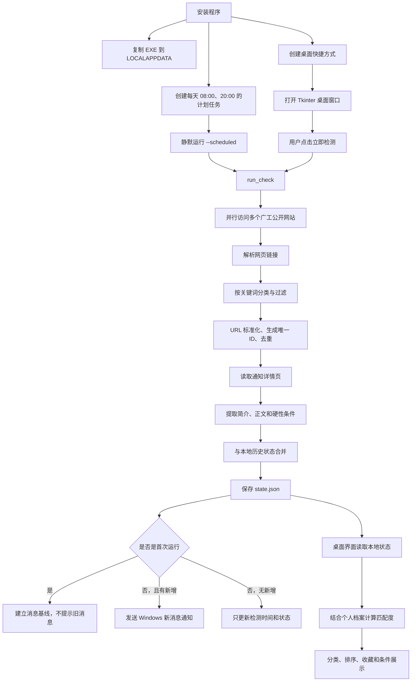
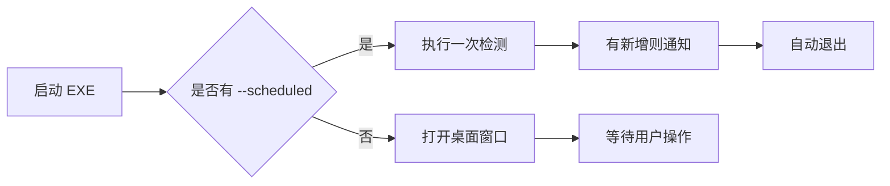

# 广工竞赛提醒：项目逻辑关系说明

## 1. 项目定位

“广工竞赛提醒”是一个面向广东工业大学学生的 Windows 本地信息聚合工具。它定时访问学校公开网站，收集并整理以下三类机会：

- 竞赛
- 实习
- 出国交流

程序既可以通过桌面窗口由用户手动操作，也可以由 Windows 计划任务以 `--scheduled` 参数静默运行。所有个人档案、收藏、历史消息和日志均保存在用户电脑本地，不上传到服务器。

## 2. 总体逻辑



项目的关键设计是：**互联网负责提供公开通知，本地状态负责记忆和个性化，桌面界面负责交互，Windows 计划任务负责自动运行。**

## 3. 代码和文件之间的关系

| 文件 | 职责 | 与其他部分的关系 |
|---|---|---|
| `src/gdut_competition_watcher.py` | 项目全部核心逻辑 | 负责采集、解析、存储、匹配、通知和桌面界面 |
| `scripts/install_tasks.ps1` | Windows 安装逻辑 | 复制 EXE、注册计划任务、创建快捷方式、首次启动 |
| `scripts/安装广工竞赛提醒.cmd` | 安装入口 | 设置 UTF-8 代码页并调用 PowerShell 安装脚本 |
| `scripts/卸载广工竞赛提醒.cmd` | 卸载入口 | 删除计划任务和桌面快捷方式，保留本地数据 |
| `requirements.txt` | Python 依赖 | 仅声明 `winotify`，用于 Windows 系统通知 |
| `README.md` | 使用和构建说明 | 描述功能、隐私、源码运行及 PyInstaller 打包方式 |

当前项目是单文件核心架构：主要业务均集中在 `gdut_competition_watcher.py` 中，没有后端服务器和数据库。

## 4. 核心数据模型

每条通知使用 `Notice` 数据类表示：

| 字段 | 含义 | 来源 |
|---|---|---|
| `id` | 通知唯一标识 | 对清理后的 URL 做 SHA-256，截取前 20 位 |
| `title` | 通知标题 | 来源网站的链接文本 |
| `url` | 原通知地址 | 相对链接与网站基础地址合并后得到 |
| `source` | 来源网站名称 | `SOURCES` 配置 |
| `date` | 页面标题中识别出的日期 | 正则表达式提取 |
| `first_seen` | 程序首次发现时间 | 本地检测时间 |
| `summary` | 通知简介 | 详情页前两段有效正文 |
| `category` | 竞赛、实习或出国 | 标题关键词分类 |
| `detail_text` | 详情页正文 | HTML 段落提取 |
| `hard_conditions` | 识别出的报名或资格条件 | 条件关键词及相邻句段 |

通知对象在采集阶段使用数据类；写入 `state.json` 前通过 `asdict` 转成普通字典，界面和匹配模块再读取这些字典。

## 5. 信息源与分类逻辑

### 5.1 信息源

程序通过 `SOURCES` 维护待检查网站。当前包括：

- 学校通知公告
- 教务处
- 学生工作处
- 国际合作与交流处
- 就业信息网

每个信息源由三部分组成：

```text
(来源名称, 首页或列表页 URL, 默认分类)
```

部分网站具有默认分类，例如国际合作网站默认偏向“出国”，就业网站默认偏向“实习”；综合网站则没有默认分类。

### 5.2 分类优先级

`classify()` 根据标题关键词分类，顺序为：

```text
实习 → 出国 → 竞赛
```

这个顺序用于处理交叉语义。例如“国际组织实习”同时具有国际交流和实习属性时，优先归为“实习”。

如果标题未直接命中某一类关键词，但来源设置了默认分类，并且标题至少命中全局机会关键词，则采用来源默认分类。

### 5.3 过滤逻辑

一条链接要成为候选通知，必须同时满足：

1. 标题长度不少于 6 个字符。
2. 能够判定为三类机会之一。
3. 不包含教师教学比赛、教职工、体育比赛成绩等忽略词。
4. 合并后的地址是 HTTP 或 HTTPS 链接。

## 6. 一次检测的完整数据流

### 6.1 读取本地状态

`run_check()` 首先调用 `load_state()` 读取：

```text
%LOCALAPPDATA%\GDUTCompetitionWatcher\state.json
```

若文件不存在或 JSON 损坏，则创建默认状态。读取时还会兼容旧数据结构，例如：

- 将旧分类名称迁移到当前分类。
- 为缺失的硬性条件补充人工核验提示。
- 将旧的毕业年份字段推算为入学年份。

### 6.2 并行采集列表页

`check_all()` 使用线程池同时访问多个网站，避免逐个请求造成等待时间过长。

每个信息源执行：

```text
fetch() 获取 HTML
  → extract_notices() 解析所有链接
  → classify() 判断分类
  → 过滤无关信息
  → 生成 Notice
```

单个网站失败不会终止整个检测。错误会：

- 加入本轮 `errors`
- 写入日志
- 在界面提示“部分来源暂时无法访问”

### 6.3 通知唯一标识与去重

通知 URL 会先删除 `#` 后面的页面锚点，再计算唯一 ID：

```text
SHA-256(clean_url) 的前 20 个十六进制字符
```

各来源本轮采集结果以 ID 为键放入字典，因此相同 URL 会自动去重。本地 `seen` 列表则用于判断该通知是否曾经出现。

### 6.4 判断新增和首次运行

```text
新增通知 = 当前通知 ID 不在历史 seen 集合中
```

但首次运行或旧版状态升级时会进入“建立基线”模式：

- 保存当前已存在的全部通知。
- 将其加入已见集合。
- 不把学校网站上原本存在的旧通知全部推送给用户。

从第二次检测开始，只有真正新出现的 URL 才会触发通知。

### 6.5 详情采集

程序复用历史中已有的 `summary`、`detail_text` 和 `hard_conditions`，只对下列通知读取详情：

- 新通知
- 以前未成功采集正文或硬性条件的旧通知

每轮最多处理 30 条详情，并通过线程池并行请求。

`ParagraphParser` 只提取 `<p>` 段落，忽略脚本、样式、导航栏和页脚。之后：

- 删除过短段落和页面模板文字。
- 前两段有效正文组成简介。
- 全部有效段落组成详情文本，最长保留 12000 字符。
- 含“报名条件”“申请资格”“专业要求”“语言要求”等标记的句段及相邻内容，被识别为硬性条件。
- 如果检测到附件、PDF、报名表等信息，追加“需要打开原通知核对附件”的提示。

详情读取失败时不会丢弃该通知，而是保存“暂时无法读取，请人工核对”的说明。

### 6.6 合并和保存

本轮通知与历史通知按 ID 合并：

- 已存在的通知保留首次发现时间及已采集详情。
- 新通知写入当前时间作为首次发现时间。
- 暂时未在当前列表页出现的历史通知仍保留。

状态规模受到限制：

- 最多保存最近 500 条通知。
- `seen` 最多保存 2000 个 ID。

最终更新：

- 初始化标记
- 已见 ID
- 通知列表
- 上次检测时间
- 上次错误
- 数据结构版本

## 7. 个人档案与匹配逻辑

个人档案保存在同一个 `state.json` 中，包含：

- 姓名
- 当前学历
- 本科入学年份
- 学院和专业
- GPA
- CET-4、CET-6
- 雅思、托福
- 意向关键词

`evaluate_notice()` 将通知标题和详情正文组合，再与档案比较。

### 7.1 基础分

- 未填写档案：默认匹配度为 50%。
- 已填写档案：基础分为 70%。

### 7.2 硬性条件

当前自动判断的硬性条件主要是：

- 仅限研究生
- 仅限本科生
- 指定毕业届别

届别按“本科入学年份 + 4”推算。若硬性条件不符合：

- 标记为 `hard_fail`
- 匹配分最高限制为 20%
- 界面以红色显示

### 7.3 数值条件

程序通过正则识别：

- CET-4 最低分
- CET-6 最低分
- 雅思最低分
- 托福最低分
- GPA 最低值

用户分数低于要求时，每项扣 10 分。当前数值条件影响得分，但不会被标记为代码层面的“硬性失败”。

### 7.4 兴趣匹配

用户可以用逗号填写多个意向关键词。关键词出现在通知文本中时：

- 每个命中项加 5 分
- 最多加 20 分

若不存在未满足条件，再额外加 10 分。最终分数限制在 0～100 之间。

### 7.5 排序关系

列表先按是否存在硬性失败分组，再按匹配分从高到低排列；同组同分时参考首次发现时间。因此，满足硬性条件且匹配度高的机会会排在前面。

## 8. 桌面界面交互关系

`MainWindow` 是主界面，主要区域包括：

- 顶部：立即检测、个人档案
- 分类栏：全部、竞赛、实习、出国
- 主列表：收藏、匹配度、分类、标题、来源、发布日期、首次发现时间
- 简介区：通知摘要和条件判断
- 底部：操作提示和打开日志

用户操作对应关系如下：

| 用户操作 | 触发逻辑 |
|---|---|
| 点击“立即检测” | 后台线程执行 `run_check()`，避免界面卡死 |
| 点击“个人档案” | 打开 `ProfileDialog`，保存后立即重新计算排序 |
| 切换分类 | 只过滤本地列表，不重新访问网站 |
| 点击收藏列 | 更新 `favorites` 并刷新列表 |
| 点击来源列 | 用默认浏览器打开原通知 |
| 双击通知 | 用默认浏览器打开原通知 |
| 选择通知 | 在下方显示简介、匹配度和已满足/未满足条件 |
| 右键通知 | 弹出完整条件匹配窗口 |
| 点击“打开日志” | 打开本地 `watcher.log` |

手动检测通过守护线程执行网络操作，完成后借助 Tkinter 的 `root.after()` 回到主线程刷新界面和显示消息框。

## 9. Windows 通知逻辑

只有同时满足以下条件才发送系统通知：

1. 本轮不是首次运行。
2. 本轮存在新通知。
3. 调用 `run_check()` 时启用了 `notify=True`。

通知内容包含：

- 新增总数
- 各分类新增数量
- 最多三条标题预览
- 其余消息数量

通知发送依赖 `winotify`。若系统通知失败，只记录日志，不影响状态保存和主流程。

## 10. 安装、定时运行与卸载

### 10.1 安装

安装流程为：

```text
用户运行安装 CMD
  → CMD 以 UTF-8 读取 PowerShell 脚本
  → 将 EXE 复制到 LOCALAPPDATA
  → 注册上午和晚上两个每日计划任务
  → 创建桌面快捷方式
  → 启动桌面程序
```

默认计划时间为每天：

- 08:00
- 20:00

计划任务使用普通用户权限，并设置：

- 错过时间后可尽快补运行
- 最长运行 5 分钟
- 启动参数为 `--scheduled`

### 10.2 两种运行模式



### 10.3 卸载

卸载脚本只删除：

- 两个 Windows 计划任务
- 桌面快捷方式

本地历史、档案、收藏、日志和程序目录仍保留在：

```text
%LOCALAPPDATA%\GDUTCompetitionWatcher
```

因此当前卸载属于“停止自动运行并移除入口”，不是彻底清除用户数据。

## 11. 本地数据之间的关系

```text
%LOCALAPPDATA%\GDUTCompetitionWatcher\
├── GDUTCompetitionWatcher.exe   # 安装后的主程序
├── state.json                   # 通知、已见记录、收藏、档案和检测状态
└── watcher.log                  # 运行记录和错误日志
```

`state.json` 是整个项目的本地数据中心，各功能通过它连接：

```mermaid
flowchart TD
    A["采集模块"] --> S["state.json"]
    B["首次运行与新增判断"] <--> S
    C["个人档案"] <--> S
    D["收藏"] <--> S
    E["GUI 列表"] <-- S
    F["匹配计算"] <-- S
    G["计划任务运行"] <--> S
```

## 12. 异常处理与降级策略

项目采用“局部失败不影响整体”的思路：

- 一个信息源失败：继续处理其他来源。
- 一个详情页失败：保留通知，提示用户人工查看。
- Windows 通知失败：记录日志，不影响检测结果。
- 状态文件不存在或损坏：使用默认状态重新开始。
- 网页只在附件或图片中展示条件：提示用户打开原通知核对。
- 网站改版导致 HTML 结构变化：可能无法识别，但不会阻止程序继续运行。

## 13. 当前架构的边界

当前实现的能力边界如下：

1. 只读取公开网页，不登录校园系统。
2. 不解析 PDF、Word、图片或微信公众号正文。
3. 分类和资格判断基于关键词和正则表达式，不是语义模型。
4. URL 是通知身份的唯一依据；同一通知换 URL 会被视为新通知。
5. 没有数据库、云端同步和多设备同步。
6. 核心逻辑集中在单个 Python 文件，功能继续扩展时需要考虑模块化。
7. 网页结构、编码或反爬策略变化，都会影响采集准确性。
8. 所有自动判断都只是辅助，报名资格最终应以学校原通知和附件为准。

## 14. 一句话总结

这个项目本质上是一条本地自动化信息管线：

```text
广工公开网站
→ 并行抓取
→ 关键词筛选与分类
→ URL 去重
→ 正文及条件提取
→ 本地历史合并
→ 个人档案匹配
→ GUI 展示 / Windows 新消息通知
```

其中，`state.json` 连接采集、历史、收藏、档案和界面；`run_check()` 是业务主入口；Windows 计划任务让它从一个手动桌面工具变成每天自动运行的提醒系统。
